# Demo walkthrough

Both flows, captured from the app running locally with `make dev-mock` (backend
`MOCK_MODEL=1` on :8000, frontend on :3000, Playwright-driven Chromium at 1280×800; the
mobile shot is 390×844). The scripted model drives the same tools and `render_ui` calls as
the live model, so what you see here is the production UI; only the extraction is keyword
based. Screenshots live in `docs/screenshots/`.

## Landing

Two cards side by side on desktop, stacked on a phone; the theme toggle (top right) switches
light and dark and the choice is remembered per browser.

| Light | Dark |
| --- | --- |
| 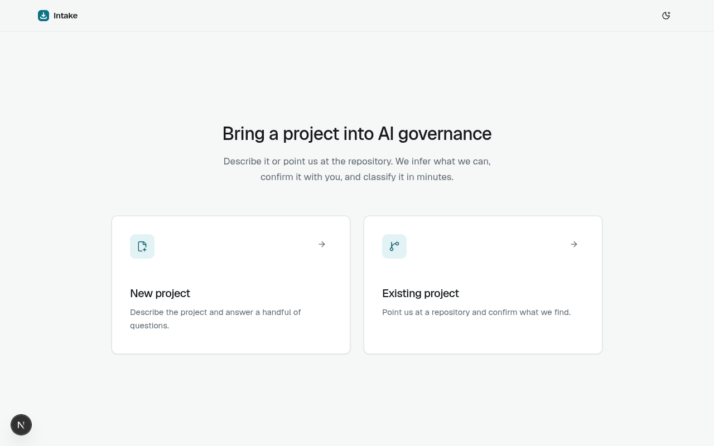 | 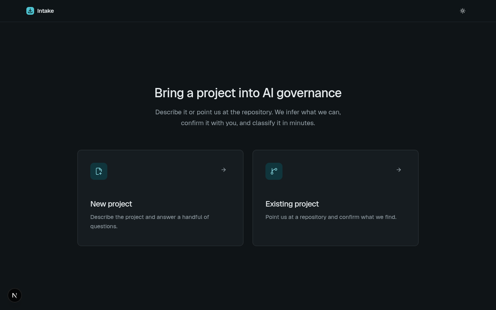 |

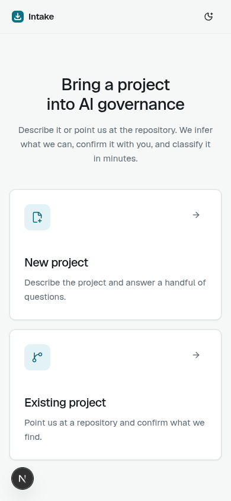

## Flow 1 — New project (HR candidate summaries)

**Scenario.** `/intake/new`, description:

> We are building an internal tool for our recruiting team that drafts job-candidate
> summaries from uploaded CVs using an LLM via the OpenAI API. Recruiters paste or upload a
> CV and the tool produces a one-page summary and a suggested fit score for the role. The
> summaries are read by recruiters before they decide who to invite to interview. It is
> currently a pilot with two hiring teams in the EU.

Name `Candidate summary assistant`, owner `Talent Acquisition Platform team`, then
**Analyze**.

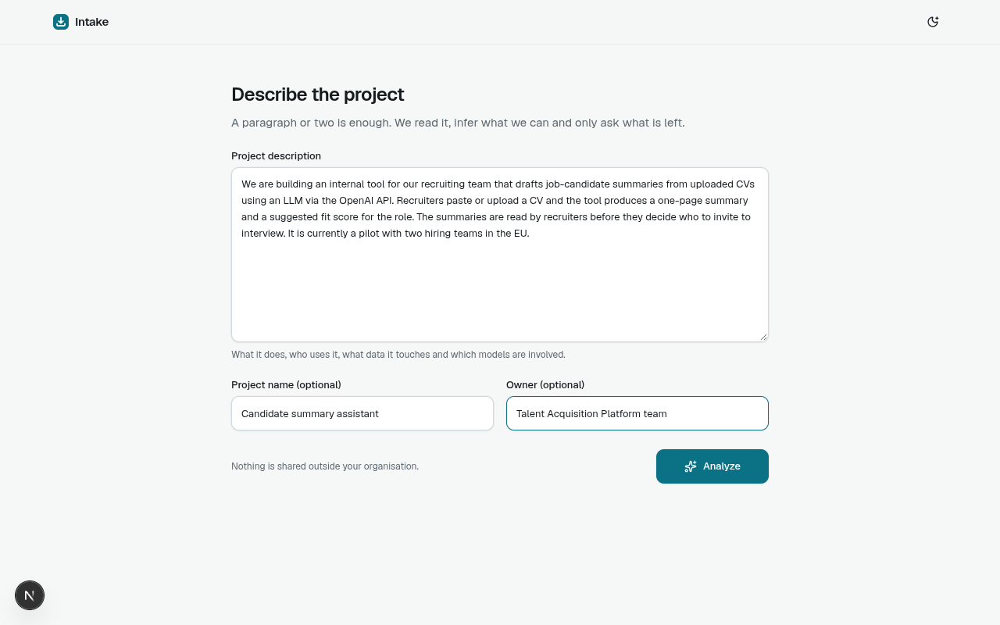

**Step 1 — chips before any question.** The agent calls `extract_intake_facts` once, then
`get_next_questions`, and renders one `InterviewStep` into the `interview` target. Thirteen
inferences arrive as chips with confidence and provenance ("What we understood"): uses AI,
personal data, HR and employment domain, pilot, internal staff, third-party API, GPAI model,
no special-category data, employees or candidates, no biometrics, generates content, no
emotion recognition, no social scoring. Only one question is left among the gates
(significant effects on people), pre-selected from a 70 % inference, with its "why asked"
line. One click on **Confirm and continue** (`data-testid="confirm-step"`) confirms every
chip and the answer in bulk.

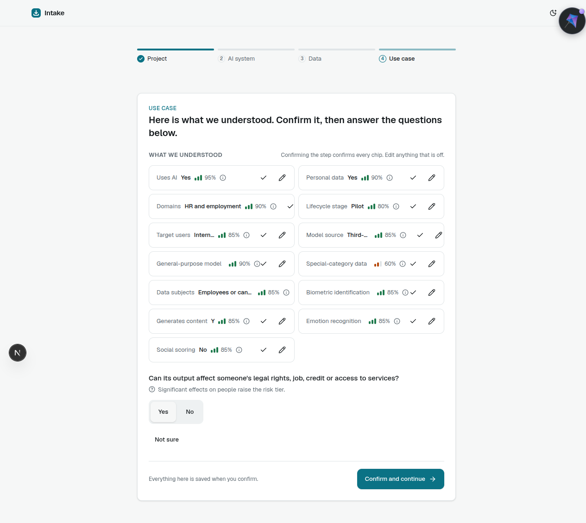

**Step 2 — AI system.** Two questions from one section: autonomy (pre-selected
"Recommends, a person decides") and human oversight. The confirm button stays disabled until
every question has an answer or "Not sure".

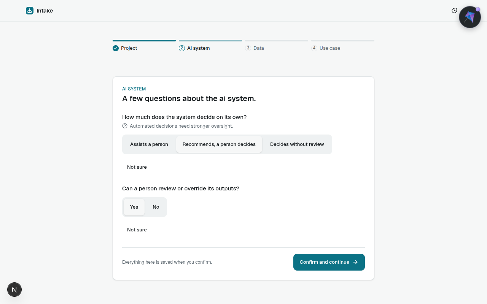

**Step 3 — Data, "Not sure".** "Is personal data used to train or fine-tune a model?" is
answered with **Not sure**; the record stores the literal `"unknown"` (distinct from `false`)
and it surfaces later as an open question.

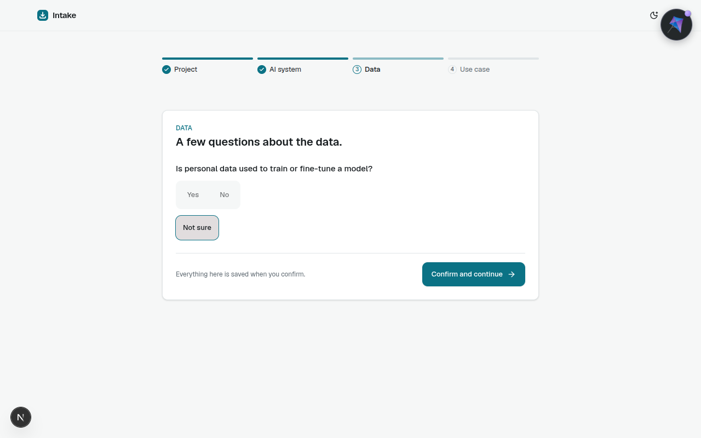

**Step 4 — Use case.** One question (direct interaction with people → No). `get_next_questions`
returns `done: true`, the agent calls `finalize_intake` and the page redirects to
`/intake/11c23848f09c/review`.

**Review.** Every field with its value, source and confidence (inline-editable; an edit
reclassifies). The classification panel shows **High risk**, Annex III 4 (employment), the
"Why" rationale linking tier → answer → article (`use_case.domains = HR and employment`,
EU AI Act Art. 6(2), Annex III 4; transparency notes under Art. 50(2); GPAI note under
Art. 53), obligations grouped by framework (EU AI Act, GDPR, NIST AI RMF, ISO/IEC 42001,
Internal AI policy), recommended next steps and the open question from step 3. JSON and PDF
downloads and Submit sit in the actions column.

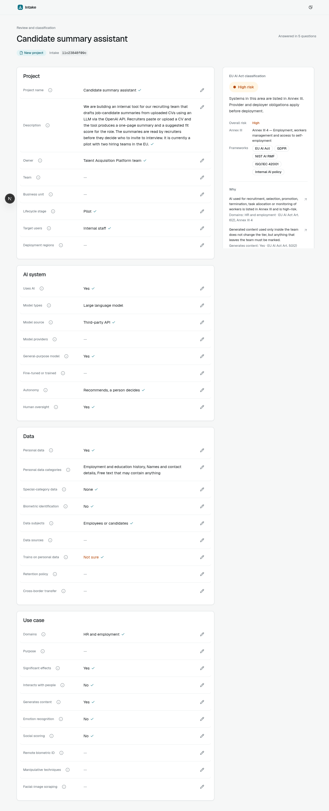

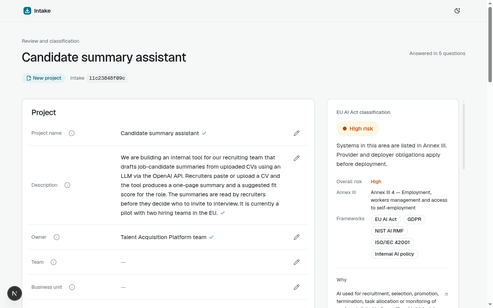

**PDF form.** `GET /api/backend/intakes/11c23848f09c/form.html` is the same template
WeasyPrint renders to `export.pdf` (30 kB, `%PDF-1.7`, verified with `curl`).

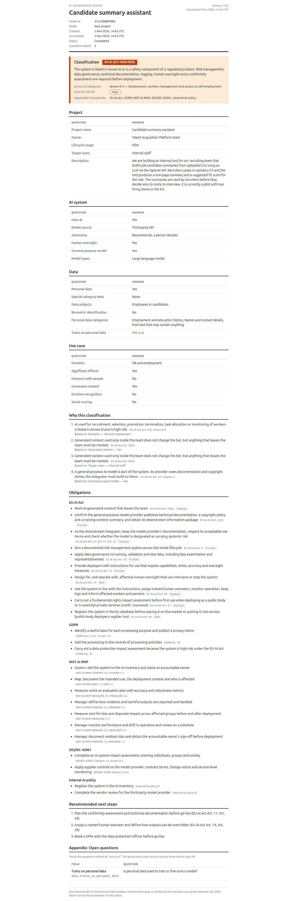

**Questions asked:** 5 (`record.meta.question_count` from `GET /api/backend/intakes/11c23848f09c`;
status `completed`, mode `new`, classification `high_risk`, overall tier `high`,
`open_questions = ["data.trains_on_personal_data"]`). `export.json` validates against
`schema/intake.schema.json`.

## Flow 2 — Existing project (repository analysis)

**Scenario.** `/intake/existing`, repository `https://github.com/intake-fixtures/hr-screening`
(a bundled fixture; `MOCK_MODEL=1` resolves it from `backend/tests/fixtures/repos/hr_screening`
without touching the network). The token field is optional and defaults to the server token.

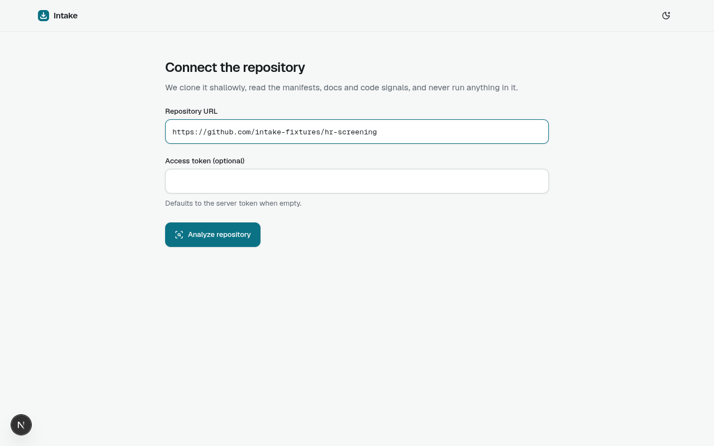

**Analysis progress.** `POST /repositories/analyze` returns a job id and the page follows
`GET /repositories/analyze/{job}/events` (SSE: "Validating repository URL", "Cloning … (shallow)",
"Scanning N files…", "Found N model integrations", "Mapping evidence onto the intake record").
The fixture repository is analysed in well under a second, so no screenshot caught the
progress list; on a real repository the lines stream in as the clone and scan run.

**Findings table.** The agent run starts after the job and renders `FindingsReview`: 22
findings, each with the inferred value, an evidence path and snippet
(`src/ranking/summarise.py`, `src/api/routes.py`, `infra/terraform/main.tf`,
`docs/retention.md`, `README.md`) and a confidence. The pencil opens an inline correction;
**Confirm and continue** accepts every row in bulk.

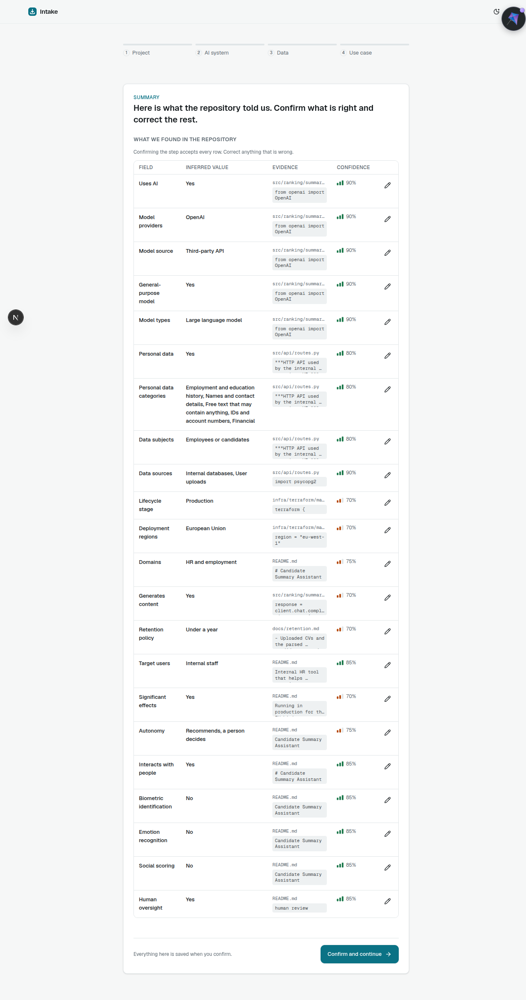

**Gap questions only.** What the repository could not answer is asked afterwards: project
name and owner (Project section), then special-category data (answered **Not sure**) and
training on personal data (No). Nothing already evidenced is asked again.

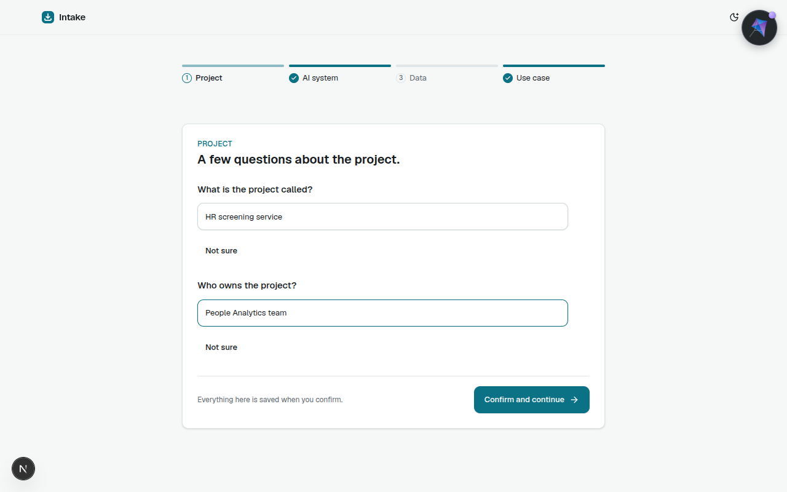

**Review in `existing` mode.** The header carries the "Existing project" badge and the
repository link; the record classifies as **High risk** (HR and employment) with the same
framework set as flow 1.

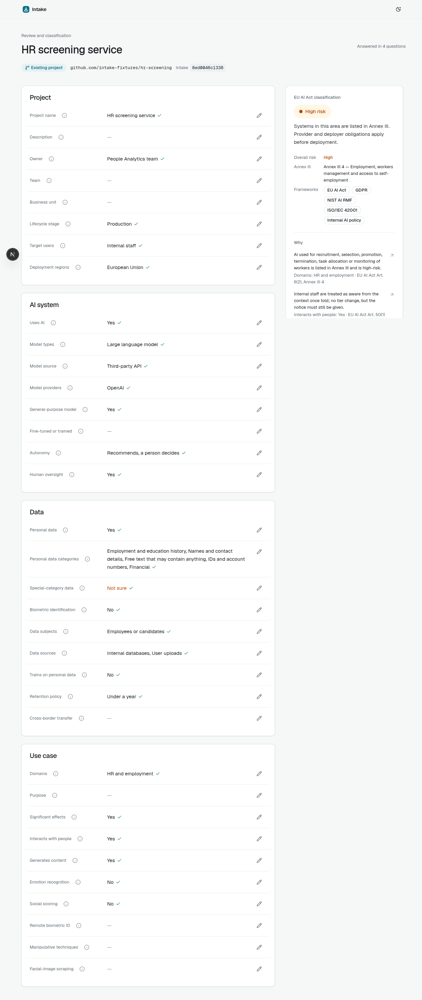

**Questions asked:** 4 (`record.meta.question_count` from `GET /api/backend/intakes/8ed0046c1338`;
status `completed`, mode `existing`, `repo_url = https://github.com/intake-fixtures/hr-screening`,
classification `high_risk`, 22 findings from `GET /api/backend/intakes/8ed0046c1338/findings`,
`open_questions = ["data.special_category_data"]`).

## Acceptance criteria

Ticked items were observed in the session above (same backend and frontend as the
screenshots). Items marked "verified by" are covered by the named target rather than by this
walkthrough.
The `make e2e` run of 2026-11-03 (Playwright starting both servers, `MOCK_MODEL=1`) passed
96 tests across chromium, firefox, webkit and Pixel 7 with 16 skipped (visual baselines are
chromium-only); `make test-backend` reported 419 tests and 100 % branch coverage of
`app/governance`; `make check-schema` reported the schema fresh.

- [x] **Assumptions before questions**: step 1 shows 13 chips and one question; inferences at
  ≥ 0.8 are never re-asked (steps 2–4 only asked what was missing or below threshold).
- [x] **≤ 8 questions for a typical project**: HR scenario finished in 5; existing-project
  scenario in 4 (`meta.question_count`).
- [x] **Gates first, batched, at most three per step**: step 1 was the open gate, later steps
  one section at a time (2, 1, 1 questions).
- [x] **Bulk confirm**: one `confirm-step` click confirmed all 13 chips (flow 1) and all 22
  findings (flow 2).
- [x] **"Not sure" always available and stores `unknown`**: step 3 (flow 1) and the
  special-category question (flow 2); both appear in `assessment.open_questions` and in the
  export with value `"unknown"`, `source: user`, `confirmed: true`.
- [x] **Why asked on sensitive questions**: the significant-effects question shows
  "Significant effects on people raise the risk tier."
- [x] **Review shows `high_risk` with the employment rationale and article citation**:
  Annex III 4, EU AI Act Art. 6(2).
- [x] **Deterministic classification from code**: both scenarios produce the same tier and
  framework list from the rules engine; the model never writes `assessment`.
- [x] **JSON export with provenance validates against `schema/intake.schema.json`**:
  checked with `jsonschema` on `export.json` of intake `11c23848f09c`.
- [x] **PDF export**: `export.pdf` returned `application/pdf`, 30 195 bytes, `%PDF-1.7`;
  HTML preview screenshot above.
- [x] **Existing project: ≥ 5 findings with evidence paths**: 22 findings, five distinct
  evidence files.
- [x] **Existing project: gap questions only, review in `existing` mode with the repository
  URL**: screenshots 14 and 15, `meta.mode = existing`, `meta.repo_url` set.
- [x] **One surface per step, each with its own `step-<n>` id, previous surface deleted**:
  the interview column never showed two steps at once across 4 + 3 steps.
- [x] **Light, dark and 390 px layouts**: screenshots 01–03 (cards stack at 390 px).
- [x] **Resumable after backend restart**: the backend restarted (a code change under
  `uvicorn --reload`) between steps 3 and 4 of the new-project run and the interview
  continued from the stored step; the URL carries the intake id. Page-reload and
  fresh-context resume assertions: verified by `make e2e` (`resume.spec.ts`).
- [x] **Disallowed repository host shows an inline error** — verified by `make e2e`
  (`existing-project.spec.ts`).
- [x] **Progress text streams during analysis** — verified by `make e2e`
  (`existing-project.spec.ts`); the fixture analysis was too fast to screenshot.
- [x] **One inline correction flips the classification** — verified by `make e2e`
  (`existing-project.spec.ts`) and `make test-backend` (`tests/api`, record service
  reclassify).
- [x] **Log-search scenario: ≤ 4 questions, `minimal`** — verified by `make e2e`
  (`new-project.spec.ts`).
- [x] **Every catalog component round-trips; client checks keep confirm disabled; editing a
  confirmed chip reopens the question** — verified by `make e2e` (`interview-controls.spec.ts`).
  (Confirm-disabled-until-answered was observed in steps 2–4.)
- [x] **Invalid component never renders; surface self-corrects; ≤ 2 sentences of agent text;
  no raw JSON outside the export** — verified by `make e2e` (`agent-guardrails.spec.ts`).
  (Agent text in this session was one sentence or none per step.)
- [x] **Accessibility: no critical/serious axe violations; both flows by keyboard** — verified
  by `make e2e` (`accessibility.spec.ts`). (Every control carried an `aria-label` in the
  snapshots used to drive this session.)
- [x] **Visual baselines light/dark, desktop/mobile** — verified by `make e2e` (`visual.spec.ts`).
- [x] **Rules engine at 100 % branch coverage** — verified by `make test-backend`
  (`--cov=app/governance --cov-fail-under=100`; 100 % at the time of writing).
- [x] **Schema and generated types fresh** — verified by `make check-schema`.
- [x] **Live model run** — `make e2e-live` on chromium against `https://llm.almckay.io/v1`
  (`Qwen3.6-35B-A3B-NVFP4`) on 2026-11-03: 23 passed, 5 skipped (visual baselines and the
  resume case are skipped when the model's wording or question count can vary), 0 failed,
  4.4 minutes. The nightly `E2E (live model)` workflow repeats it.

## Reproduce

```sh
make dev-mock                     # terminal 1
open http://localhost:3000        # follow the steps above
curl -s localhost:8000/intakes/<id> | jq .record.meta.question_count
```

The exact DOM hooks used above: `project-description`, `project-name`, `project-owner`,
`analyze`, `repo-url`, `analyze-repository`, `confirm-step`, `not-sure`, `assumption-chip`,
`finding-row`, `classification-summary`, `review-mode`, `download-pdf`, `download-json`,
`submit-intake` (all `data-testid`).
